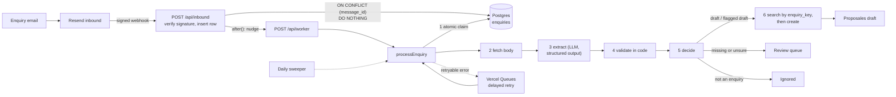
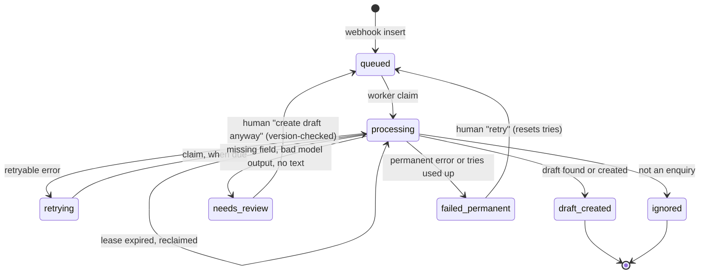

<p align="center">
  
</p>

<h1 align="center">Inbox to Draft</h1>

<p align="center">
  A hotel enquiry arrives by email. A draft proposal is waiting in <a href="https://proposales.com">Proposales</a> moments later.<br>
  <em>The model proposes, code decides, a human sends.</em>
</p>

<p align="center">
  <a href="https://proposales-technical-case-six.vercel.app/"><strong>Live demo</strong></a> ·
  <a href="#when-things-go-wrong">When things go wrong</a> ·
  <a href="#concurrency-two-requests-changing-the-same-thing">Concurrency</a> ·
  <a href="#known-limits-and-weaknesses">Known limits</a>
</p>

> [!NOTE]
> **This is a public demo.** Anyone can open it and anyone can email the inbound address, by design.
> Email **addresses** are masked everywhere they appear (`a***@domain.com`), and a row is visible for 15 minutes after its last change. **The rest of an email is not masked:** opening a row shows its body as plain text, including any names, companies or phone numbers in it, so **do not send real personal data to this demo**. LLM spend is capped at **$5 per month** in the Vercel AI Gateway. Nothing is ever sent to a customer: the system only creates **drafts**.

## Contents

- [The problem](#the-problem)
- [Try it in a minute](#try-it-in-a-minute)
- [How it works](#how-it-works)
- [What the model decides, and what it does not](#what-the-model-decides-and-what-it-does-not)
- [When things go wrong](#when-things-go-wrong)
- [Duplicates: one enquiry, one draft](#duplicates-one-enquiry-one-draft)
- [Concurrency: two requests changing the same thing](#concurrency-two-requests-changing-the-same-thing)
- [Tests](#tests)
- [Evaluation of the extraction](#evaluation-of-the-extraction)
- [Known limits and weaknesses](#known-limits-and-weaknesses)
- [Scope: what I cut and why](#scope-what-i-cut-and-why)
- [Design decisions](#design-decisions)
- [Proposales API notes](#proposales-api-notes)
- [Run it yourself](#run-it-yourself)
- [Repository map](#repository-map)
- [How this was built](#how-this-was-built)

## The problem

Hotel salespeople lose hours copying enquiries from emails into proposals. The copying is mechanical, but the reading is not: "20 of us, the week after Easter, we'd like lunch both days and maybe a room for the board" has to become dates, a head count, and the right products from the hotel's catalogue.

Inbox to Draft does the copying and the first reading. An enquiry email goes in; a draft proposal with the right dates, guests, language and product blocks comes out in Proposales, usually within seconds. The salesperson opens the draft, checks it, edits it and sends it.

The interesting part is not the happy path. It is deciding what to do when the model is unsure, when Proposales is down, when the same email arrives twice, and when two people (or two workers) touch the same row at once. Those answers are the bulk of this document.

## Try it in a minute

1. Open the **[live dashboard](https://proposales-technical-case-six.vercel.app/)**. The inbound email address is at the top right and in the intro panel (click to copy, or scan the QR code).
2. Email it an enquiry, for example:

   > Subject: Team offsite in March
   > Hi, we are 24 people and would like to come 12 to 14 March. We need a meeting room, lunch both days and a dinner on the first night. Thanks, Sara

3. Watch the row appear and move **queued → processing → draft created**. Click it to see the extracted fields, the evidence quote behind each one, the timeline of steps, and a link to the draft in Proposales.
4. Try the awkward ones:
   - A vague email ("we want to book something sometime") lands in the **review queue** instead of making a bad draft. Fill in the missing fields and press **Create draft anyway**.
   - Send the same email twice. You get one draft, not two.
   - Send a newsletter or an out-of-office reply. It is marked **ignored**.

> [!TIP]
> Drafts live in the Proposales account behind the configured API key, so the draft link needs a login for that account. The dashboard shows everything else (fields, evidence, flags, timeline) without one.

## How it works



**The flow, in plain words**

1. **Intake.** Resend receives the email and calls `POST /api/inbound` with a signed webhook (Svix signature, checked; a bad signature is a 401 and nothing is stored). The webhook carries metadata only, so the route inserts a `queued` row keyed by the unique `message_id` and returns. If the insert fails the route returns 500 so Resend redelivers.
2. **Nudge.** After responding, `after()` pokes `POST /api/worker` (bearer-protected). The worker returns `202` at once and processes inside `after()`. The webhook never waits on the LLM.
3. **Process.** `processEnquiry` ([`lib/pipeline/process.ts`](lib/pipeline/process.ts)) claims the row, fetches the email body, extracts structured fields with the LLM, validates every field in code, decides an outcome, then searches Proposales for an existing draft before creating one.
4. **Recover.** Every claim schedules a watchdog message, retryable failures schedule delayed retries (Vercel Queues), and a daily cron sweeper catches anything the first two missed.
5. **Look.** The dashboard polls a read-only API. The salesperson sees the pipeline, the review queue, and the timeline for each enquiry.

**Status machine.** Seven statuses, enforced by a `CHECK` constraint. Each transition is made by exactly one kind of actor.



**Stack.** Next.js 16 (App Router) and React 19 on Vercel, Postgres on Neon via `postgres.js` with plain SQL migrations (no ORM), Vercel AI SDK 6 through the AI Gateway, Resend for inbound email, Vercel Queues for delayed retries, Zod 4 for schemas, Vitest 4 for tests, Tailwind 4 for the UI.

## What the model decides, and what it does not

The email is **data, never instructions**. The model reads it and fills in a schema. Everything after that is ordinary code that does not trust the model.

| The model does | Code does |
| --- | --- |
| Reads the email and fills a Zod schema (dates, guests, language, products, optional quantities) | Verifies every value before it is used |
| Gives each field a confidence from 0 to 1 and **copies the exact words** that justify it | Rejects any field whose quote is not found in the email, character for character |
| Picks products by `variation_id` from the catalogue it is shown | Drops any id that is not in the live catalogue. Invented ids cannot reach Proposales |
| Says whether the email is an enquiry at all | Decides the outcome (below) with fixed rules |
| | Works out default quantities (lunch for 24 guests on 2 days is 48) |
| | Creates the draft. A human sends it |

**Validation rules** ([`lib/extraction/validate.ts`](lib/extraction/validate.ts), thresholds in [`lib/extraction/policy.ts`](lib/extraction/policy.ts)):

| Check | Result |
| --- | --- |
| Evidence quote not in the email | Field dropped (a hallucination, however confident) |
| Confidence ≥ 0.8 | Trusted |
| Confidence 0.6 to 0.8 | Trusted, flagged "check this" |
| Confidence < 0.6 | Critical field dropped; others flagged "low confidence" |
| Date not a real calendar day, in the past, or end before start | Dropped |
| Start date within 7 days | Flagged "short notice" |
| Guests not a whole number from 1 to 1000 | Dropped (typo or junk) |
| Guests above 200 | Valid, flagged "very large group" |
| Product id not in the catalogue, or confidence < 0.6 | Dropped |
| Language unknown | Defaults to `en`, flagged |
| Email longer than 20,000 characters | Cut, flagged; the full text stays in the database |

**The outcome**, first match wins ([`lib/extraction/decide.ts`](lib/extraction/decide.ts)):

1. Not an enquiry → **ignored**.
2. `startDate` or `guests` missing after validation → **needs review**, with a reason per missing field. A bad guess here would be worse than a gap.
3. Any flag on a draft-level field (dates, guests, products, language, truncation) → **flagged draft**: created, but the flags are visible so the salesperson looks twice.
4. Otherwise → **draft**.

Everything else the model returns (company, budget, notes) is stored and shown but never blocks a draft.

**Handling the model being wrong or broken.** Invalid structured output gets one immediate retry, then the row goes to the review queue rather than failing. Provider errors (timeouts, rate limits, 5xx) are retried with backoff, but give up after 3 tries instead of 5, because every model try costs money. The saved extraction is reused on retry, so a retry never pays for the model twice.

**Prompt injection.** The email is wrapped in a delimiter, the closing delimiter inside the email is neutralised, and the model has no tools, so there is nothing for an injected instruction to call. The worst a hostile email can do is produce odd field values, which the checks above then reject or flag. There is an injection sample in the eval set.

**Which model.** `openai/gpt-5.4-nano` through the Vercel AI Gateway, chosen on cost and speed (about 2.9 s and 2,200 tokens per email). Set it with `EXTRACTION_MODEL`.

> [!WARNING]
> The built-in default in [`lib/extraction/extract.ts`](lib/extraction/extract.ts) is `anthropic/claude-haiku-4.5`, which my gateway tier rejected and which I have **not** evaluated. The model I evaluated and deployed is the one above. If you run this yourself, set `EXTRACTION_MODEL` explicitly.

## When things go wrong

Every external failure is classified in **one function** ([`lib/proposales/errors.ts`](lib/proposales/errors.ts)) as retryable or permanent. Nothing catches an error and reports success.

| What happened | Classified as | What the system does |
| --- | --- | --- |
| Proposales 5xx, timeout, dropped connection | Retryable | Park as `retrying`, delayed retry with backoff |
| Proposales 429 | Retryable | Same, and waits at least as long as `Retry-After` |
| Database connection blip | Retryable | Same |
| Email body fetch hangs (10 s timeout) | Retryable | Same |
| LLM provider error or timeout (25 s) | Retryable, cap 3 | Same, gives up sooner to protect spend |
| LLM returns invalid output | Handled in-step | One immediate retry, then **review queue** |
| Proposales 400 / 422 (bad request) | Permanent | `failed_permanent` at once. The response (first 200 chars) is saved on the row. Retrying an invalid request cannot help |
| Proposales 401 / 403 (bad or revoked key) | Permanent, **loud** | `failed_permanent` and a banner on the dashboard. No endless retrying |
| Any other 4xx, unrecognised error, malformed 2xx | Permanent | `failed_permanent`. Unknown means unsafe to repeat |
| Bad webhook signature | Rejected | 401, nothing stored |
| Worker crashes mid-run | Recovered | Lease expires, watchdog and sweeper reclaim the row |
| A queue message is lost | Recovered | Daily sweeper nudges stuck rows |
| Proposales down for hours | Degraded gracefully | Health pings flip a banner; rows keep retrying; nothing is lost |

**Retries.** Backoff is 30 s, 2 min, 10 min, then 1 h, with ±10% jitter so a recovery does not stampede. The cap is 5 tries (3 for model errors). After the cap the row is `failed_permanent`, the reason is on the row, and a human can press **Retry now** (which resets the try counter only).

**How retries are driven.** A retryable failure first *parks* the row (`status = retrying`, `next_attempt_at` set), and only then enqueues a delayed Vercel Queues message to wake it. The order matters: if the message is lost, the row is already safely parked and the sweeper finds it. Every claim also schedules a *watchdog* message just after the lease would expire, so a crashed worker's row is picked up in about two minutes, not at the next cron run.

**The sweeper** ([`lib/pipeline/sweeper.ts`](lib/pipeline/sweeper.ts)) runs daily (Vercel cron) and from a **Retry stuck enquiries** button. It fails rows that have crashed repeatedly, and nudges up to 10 stuck rows per run. It is idempotent: running it twice is harmless.

**Health.** A cheap, rate-limited ping (at most once per 60 s) tracks whether Proposales is reachable. Two failed pings mean "down" and show a banner; an auth failure shows the banner at once.

**A chaos switch** lets me prove the above on demand. It makes the Proposales client fail on purpose, and is a presenter tool (bearer-protected, no UI):

```bash
curl -X POST https://proposales-technical-case-six.vercel.app/api/chaos \
  -H "Authorization: Bearer $CRON_SECRET" -H "content-type: application/json" -d '{"on": true}'
```

Send an email: the row goes to `retrying` with a visible next-attempt time. Switch chaos off and press **Retry stuck enquiries**: the draft appears with no manual fix.

> [!IMPORTANT]
> I ran this live on the deployed site for: the same webhook replayed twice, outage with chaos on, recovery after chaos off, and a stale-version edit. The other failure modes (invalid request, wrong key, crash after create, parallel claims, garbage model output) are covered by automated tests against a real Postgres, not by a live run.

## Duplicates: one enquiry, one draft

Proposales has **no idempotency key**: creating twice makes two drafts (I verified this against the live API). So uniqueness has to be enforced on my side, in layers, each covering a hole the previous one leaves:

1. **Provider redelivery.** `message_id` is `UNIQUE` and the insert is `ON CONFLICT DO NOTHING`. Replaying a webhook changes nothing. *It does not catch the same text sent twice*, because each send has a new Message-ID.
2. **Two workers, one row.** The atomic claim (next section) means only one worker runs a given row at a time.
3. **Same text sent again.** A fingerprint (sha256 of sender plus the lowercased, whitespace-normalised body) is checked inside a transaction behind a Postgres advisory lock, with a 7-day window. One `SELECT` returns one of three answers: *proceed* (new), *wait* (an identical enquiry is still in flight, retry shortly), or *adopt* (it already has a draft; link to it, no model call, no second draft). This layer exists because I sent the same text three times by hand and got three drafts. A first version used two statements and raced; a concurrency test caught it and it is now one statement.
4. **At Proposales.** Before creating, always search by `enquiry_key` (the enquiry's UUID, stored in the draft's `data`). The same create call writes the key, so the key and the draft are born together. The client re-checks the key on every search hit, takes the oldest match, and never adopts a draft that carries someone else's key.
5. **Crash between create and save.** If a worker creates the draft and dies before saving the link, the retry searches first and finds it. The step order is *search, create, save*, and a test forces a crash exactly after create and asserts one draft.

The extraction is saved before the create step, so the part that costs money is never repeated.

> [!NOTE]
> Layers 3 to 5 are probabilistic at the edges. See [known limits](#known-limits-and-weaknesses) for the three situations that can still produce a second draft.

## Concurrency: two requests changing the same thing

There are two kinds of contention: workers racing for a row, and humans racing to edit one.

### Workers: an atomic claim with a lease and a fencing token

The claim is a **single conditional `UPDATE`** ([`lib/db/enquiries.ts`](lib/db/enquiries.ts)), never a read followed by a write:

```sql
UPDATE enquiries
SET status = 'processing',
    locked_until = now() + interval '2 minutes',
    attempts = attempts + 1,
    tries = tries + 1,
    updated_at = now()
WHERE id = $1
  AND tries < $max
  AND ( status = 'queued'
        OR (status = 'retrying'  AND next_attempt_at <= now())
        OR (status = 'processing' AND locked_until < now()) )
RETURNING ...
```

Postgres serialises concurrent updates on the same row, so when twenty workers fire at once exactly one gets a row back and the rest get nothing. A worker that dies simply lets its lease run out and the next claim takes over.

Two counters, deliberately separate:

- **`attempts`** is a *fencing token*. It goes up on every claim and is never reset.
- **`tries`** is the *retry budget*. It feeds the cap and is reset only by a human retry.

**Fenced writes.** The lease can expire while a slow worker is still running (the classic zombie). So every write after the claim is guarded with `WHERE status = 'processing' AND attempts = <my ticket>`. If another worker took over, the guard matches zero rows, the write throws `LostLeaseError`, and the zombie stops quietly. Whatever the newer worker saves is the truth. `maxDuration` is set to 110 s, under the 120 s lease, so a function is killed before its lease could be stolen.

### Humans: optimistic locking with a version column

Editing a row in the review queue sends `{ version, changes }` with **only the fields that changed**. The server applies it as one statement:

```sql
UPDATE enquiries SET extracted = <merged>, version = version + 1
WHERE id = $1 AND version = $2 AND status = 'needs_review'
```

A stale version, or a row that already left review, updates nothing and returns **409** with the current state. The UI reloads, keeps what the user typed, and only asks "yours or theirs?" for fields *both* sides changed. Because edits are field-level, two people editing different fields do not collide at all.

**"Create draft anyway"** (push a flagged enquiry through despite warnings) is guarded by the same version check. Ten simultaneous presses produce exactly one winner, and the hard rules (real dates, valid guests) are still enforced server-side, returning 422 if broken. A hand-entered value is marked with an "(entered by hand)" evidence tag that the validator trusts **only** when the override flag is set, so the tag cannot be spoofed to bypass the quote check.

## Tests

**562 tests in 27 files**, all passing, plus a clean lint and typecheck.

The database tests run against **real Postgres** on a throwaway Neon branch (`DATABASE_URL_TEST`), not a mock, because the guarantees live in SQL. A guard refuses to run if the test URL points at the same host as the live database (the tests drop tables). Proposales is replaced by an in-memory fake that behaves like the real API, and the fake's responses are themselves validated against the OpenAPI schema and against responses I recorded from the real API ([`fixtures/proposales/`](fixtures/proposales)). A fault-injection hook (`faults.afterCreate`, never set in production) simulates a crash at an exact line.

For each reliability guarantee there is a test that **fails without the fix**:

| Guarantee | Where it is proven |
| --- | --- |
| 20 parallel claims, exactly one wins | [`tests/claim.test.ts`](tests/claim.test.ts) |
| Expired lease taken over; finished rows never reclaimed | [`tests/pipeline.test.ts`](tests/pipeline.test.ts) ("the claim") |
| A worker that lost its lease cannot write | [`tests/pipeline.test.ts`](tests/pipeline.test.ts), [`tests/claim.test.ts`](tests/claim.test.ts) |
| Stale-version edit gets 409; two simultaneous edits; only one wins | [`tests/claim.test.ts`](tests/claim.test.ts), [`tests/override.db.test.ts`](tests/override.db.test.ts) |
| Ten "create anyway" presses, one winner; hand tag ignored without override | [`tests/override.db.test.ts`](tests/override.db.test.ts), [`tests/claim.test.ts`](tests/claim.test.ts) |
| Crash after create, then retry: one draft; five workers racing | [`tests/pipeline.test.ts`](tests/pipeline.test.ts) |
| Same text sent five times concurrently: one draft | [`tests/pipeline.test.ts`](tests/pipeline.test.ts) |
| Error classification, `Retry-After`, 4xx never retried (except 429) | [`tests/proposales.client.test.ts`](tests/proposales.client.test.ts), [`tests/retry.test.ts`](tests/retry.test.ts) |
| Backoff, caps, delayed wake-up and watchdog | [`tests/retry.test.ts`](tests/retry.test.ts), [`tests/queue.test.ts`](tests/queue.test.ts) |
| Sweeper: stuck rows, crash-looped rows, idempotent | [`tests/sweeper.test.ts`](tests/sweeper.test.ts) |
| Webhook: signature, duplicate delivery, no public write route | [`tests/intake.test.ts`](tests/intake.test.ts) |
| Chaos switch and health flag | [`tests/chaos.test.ts`](tests/chaos.test.ts) |
| Quote check, dates, guest range, catalogue ids, injection delimiter | [`tests/extraction.validate.test.ts`](tests/extraction.validate.test.ts), [`tests/extraction.test.ts`](tests/extraction.test.ts) |
| Every outcome of the decision function | [`tests/extraction.decide.test.ts`](tests/extraction.decide.test.ts) |
| Emails masked, 15-minute window, no email text in saved errors or events | [`tests/mask.test.ts`](tests/mask.test.ts), [`tests/dashboard.db.test.ts`](tests/dashboard.db.test.ts), [`tests/pipeline.test.ts`](tests/pipeline.test.ts) |

I also broke the code on purpose (removed the lease check, the version check, the search-before-create) and confirmed the matching test goes red, so the tests are not decorative.

One test documents a failure instead of hiding it: `known limit: no sender and a lagging key search lets the retry create a second draft`.

**Not covered by tests:** the review editor and the polling hook have no component or browser tests. Real Vercel Queues delivery was proven once, live, not in CI.

```bash
npm test          # needs DATABASE_URL_TEST (a throwaway Neon branch)
npm run lint
npm run typecheck
```

## Evaluation of the extraction

`npm run eval` runs the extraction (then validation and decision) over [19 sample emails](fixtures/enquiries) with expected results, and scores each field. "Today" is fixed at 2026-11-04 so relative dates are stable. Full output: [`fixtures/enquiries/results.md`](fixtures/enquiries/results.md).

The samples cover: a clean request, a vague one, no dates, no year, a past date, conflicting dates, a typo in the guest count, a forwarded thread, German and Swedish emails, a dinner for a share of the guests, a wedding with rooms, an AV-only request, a newsletter, an out-of-office, a non-enquiry, and a prompt-injection attempt.

**Prompt v4, `openai/gpt-5.4-nano`, 19 samples**

| Field | Pass rate |
| --- | --- |
| Start date | 94% (15/16) |
| End date | 100% (3/3) |
| Guests | 100% (16/16) |
| Products | 92% (12/13) |
| Language | 100% (15/15) |
| Final outcome | 95% (18/19) |
| **Samples fully correct** | **89% (17/19)** |
| Evidence quotes not found in the email | 0 |
| Average per email | 2.9 s, 2,232 tokens |

Prompt v3 scored 84% fully correct (16/19), with one quote not found. v4 tightened the end-date rule (never copy the start date for a one-day event) and the relative-date rule ([`results-v3.md`](fixtures/enquiries/results-v3.md) keeps the earlier run for comparison).

**The two failures, honestly**

- **`relative-date` ("next Friday")** is a real weakness. Today is Wednesday 4 Nov, and the expected answer is Friday 13 Nov (Friday of the *following* week). The model returns the nearest Friday (6 Nov) despite an explicit rule in the prompt. "Next Friday" is genuinely ambiguous in English, so some humans would also read it as 6 Nov, but I decided on the stricter reading and the model does not follow it reliably. The safety net held: the wrong date is two days away, which trips the short-notice flag, so the result was a *flagged* draft a human would look at, not a silent wrong one. Prose rules did not fix it. The real fix is code: resolve relative-weekday phrases deterministically before or after the model. I did not build that.
- **`wedding-rooms`**: the email asks for two products, the model finds one. A missed product is visible in the draft and cheap to add; an invented one would not survive the catalogue check.

> [!WARNING]
> **What this eval does and does not show.** The 19 samples are written by me and I tuned the prompt against them, so 89% is "on my own set", not a general accuracy claim. It is one run per prompt version, and this model ignores the temperature setting, so a point or two between runs is noise (`clean` failed on v3 and passed on v4 with no relevant change). No messy real-world emails (long threads, HTML-only) are in the set, and I have not compared a second model. The eval calls the real model, so it is manual and costs money; it is not in CI.
>
> What makes this acceptable is the design rather than the number: every value is checked in code, anything unsure is flagged, and a human sends every draft. The rest of the system is built to make a wrong extraction cheap, not impossible.

## Known limits and weaknesses

I would rather you hear these from me.

**Duplicates can still happen in three narrow cases** (a test names the first):

1. **No sender address, and Proposales search is lagging** right after a create. The retry cannot find the draft by key and makes a second. In my probe search was consistent in 0.2 s and retries wait at least 30 s, so this needs both a missing sender and an unusual lag.
2. **A worker stalls past its lease between the search and the create.** The fence stops its database writes but not the call already in flight to Proposales. `maxDuration` (110 s) below the lease (120 s) is the mitigation, and it cannot be tested locally.
3. **A first row crashes after create, then runs out of tries,** and then the same email is sent again. The repeat cannot adopt a draft the first row never recorded.

The fingerprint also only catches the **same sender and same text**. Rewording or sending from another address is, correctly, a new enquiry.

**Platform limits**

- Vercel Queues is in beta (`queue/v2beta`), and the trigger config may change. A message is delivered to the deployment that sent it. A lost message waits up to a day for the cron, because the Hobby plan only allows daily crons.
- AI Gateway free-tier models allow about 5 requests per minute. Bursts of enquiries queue behind that limit and retry.
- The $5 monthly budget is a hard stop. If it is exhausted, extraction fails; depending on the status the gateway returns, a row retries or lands in `failed_permanent`, and can be retried by hand from the dashboard when the budget is back.

**Deliberate openness (it is a demo)**

- The inbound address is public and the edit, create-anyway, retry and sweeper endpoints are open to every visitor. Mitigations: email-address masking, a 15-minute visibility window, a 20,000-character cap per email, content-fingerprint dedupe (a repeated email costs no model call), and the $5 gateway cap.
- **Privacy is partial.** Masking is a regex over email addresses only ([`lib/db/mask.ts`](lib/db/mask.ts)). The list view shows just sender and subject, but the detail view (`GET /api/enquiries/[id]`) returns the body as plain text, so names, companies and anything else written in an email are visible to any visitor for 15 minutes. That is what lets a reviewer compare the email with what the AI read, and it is why the demo asks people not to send real personal data. A real deployment would put this behind login and mask or drop the body. There is no per-sender rate limit. A real deployment would put authentication in front of the write endpoints.
- "Create draft anyway" can create a real draft in the connected Proposales account. Drafts are inert until a human sends them.

**Product limits**

- One company, one catalogue, one language of output per draft. No multi-tenancy.
- Dates go into the draft title and description: a Proposales draft has no date field.
- The product match relies on catalogue titles in English for default quantities (lunch, dinner, hotel room, meeting room, AV package). A renamed product falls back to a quantity of one.
- Thresholds (0.8 / 0.6 confidence, 1,000 max guests, 7-day short notice) are reasonable starting points, not tuned on real traffic. They sit in one file so changing them is one edit.
- The list polls rather than streaming, so the dashboard can lag by a few seconds.

## Scope: what I cut and why

| Cut | Why |
| --- | --- |
| Paste-an-enquiry form and a "try it" page | Email is the real source and the magic moment. A paste box is a second intake path to secure, with no extra insight |
| Password gate on writes | A demo that asks reviewers for a password is a demo reviewers do not try. The cost of openness is bounded (masking, window, spend cap, drafts are inert) |
| Replying to the sender / sending the proposal | Sending to a customer is a human decision. The product's promise is a *draft* |
| Auth, roles, multi-tenancy | One hotel is enough to show the pipeline. Isolation would be the first step of a real rollout |
| Deterministic relative-date resolution | Would fix the known "next Friday" failure. Next on the list |
| Per-sender rate limiting and a code-level spend cap | The gateway budget bounds the damage today. A daily call cap in Postgres is the clean next step |
| Reconciliation job for duplicate `enquiry_key`s | Would close the narrow duplicate cases above by detecting rather than preventing them |

## Design decisions

| Decision | Why | Rejected |
| --- | --- | --- |
| **Postgres is the source of truth and the queue's state**, with plain SQL migrations | The guarantees (claim, version check, dedupe) are atomic SQL statements I can reason about and test | An ORM hiding the statements; a queue as the only record |
| **Webhook inserts and returns**; work happens after | A webhook that waits on an LLM times out and gets redelivered | Doing the LLM call in the webhook |
| **`after()` nudge + Vercel Queues + daily cron** | Nudge for speed, delayed messages for retries, cron as the net under both. No single moving part is load-bearing | Cron-only (slow); queue-only (a lost message loses work) |
| **Lease + fencing token (`attempts`)** | Leases survive crashes; the token stops zombies from writing | A lock with no expiry; a lease with no fence |
| **Separate `tries` from `attempts`** | A human retry should reset the budget without resetting the fence | One counter |
| **Park the row, then enqueue** | A lost message must never lose the retry | Enqueue first |
| **Evidence quotes, checked in code** | Makes hallucination detectable, not just discouraged | Trusting confidence scores alone |
| **Code owns outcomes, quantities and catalogue ids** | The model's job is reading, not deciding what a hotel sells | Letting the model pick quantities or invent ids |
| **Flag instead of block, except for dates and guests** | A flagged draft is useful; a missing date makes a draft misleading | Blocking on every uncertainty (nothing ever ships), or none (wrong drafts ship) |
| **Search before create, key in the create call** | The only idempotency available when the API offers none | Trusting the API to dedupe |
| **One classifier for retryable vs permanent** | Retry policy in one place cannot drift between call sites | `try/catch` at each call |
| **Real Postgres in tests** | A mocked database cannot catch a race | pg-mem / mocks |

## Proposales API notes

Endpoints used (base `https://api.proposales.com`, bearer key, 10 s timeout, no retries inside the client; retry policy lives in the pipeline): `GET /v3/companies`, `GET /v3/content` (catalogue), `POST /v3/proposals`, `GET /v3/proposal-search`.

Things I found by probing the real API, recorded in [`fixtures/proposales/`](fixtures/proposales) and asserted in tests:

- **No idempotency key.** Two creates, two drafts.
- **`content_id` must be a *variation* id.** A product id is accepted and silently produces a draft with zero blocks.
- **A draft has no date field.** Dates go in the title and description.
- **Search by `data` property works** and was consistent after about 0.2 s; results are newest first with no pagination.
- **Catalogue entries show no prices**; prices appear only inside a draft's blocks. Catalogue descriptions end in an invisible U+200E character.
- **A new account breaks its own spec** on `/v3/companies` (`timezone: null`, `website_url: ""`), so the client validates only what it uses.
- Timestamps are milliseconds. Errors are `{ error: { message, issues[] } }`.

## Run it yourself

**Prerequisites:** Node 20+, a Neon Postgres database (plus a second throwaway branch for tests), a Proposales account with an API key (Settings → Profile), a Vercel project with AI Gateway enabled, and a Resend account with an inbound address.

```bash
cp .env.example .env     # fill in the values below
npm install
npm run migrate          # applies migrations/*.sql
npm run dev
```

| Variable | Purpose |
| --- | --- |
| `DATABASE_URL`, `DATABASE_URL_UNPOOLED` | Neon Postgres (pooled and direct) |
| `DATABASE_URL_TEST` | Throwaway Neon branch for tests. **Must differ** from the two above, tests drop tables |
| `EMAIL_WEBHOOK_SECRET`, `RESEND_API_KEY` | Resend inbound webhook signing secret, and API key to fetch email bodies |
| `NEXT_PUBLIC_INBOUND_ADDRESS` | The address people email. Baked in at build time: redeploy after changing |
| `WORKER_SECRET` | Bearer for the internal `/api/worker` nudge (`openssl rand -hex 32`) |
| `CRON_SECRET` | Bearer for `/api/sweeper` (Vercel cron sends it automatically) and `/api/chaos`. Different from `WORKER_SECRET` |
| `PROPOSALES_API_KEY`, `PROPOSALES_COMPANY_ID` | Proposales access. With no key, a local in-memory fake is used (development convenience only) |
| `PROPOSALES_BASE_URL` | Optional override of the API base URL |
| `AI_GATEWAY_API_KEY` | Vercel AI Gateway (read by the AI SDK itself) |
| `EXTRACTION_MODEL` | Gateway model id. Set it explicitly (see the warning above) |

| Command | What it does |
| --- | --- |
| `npm run dev` / `build` / `start` | Next.js development, production build, serve |
| `npm test` | Vitest, including the concurrency tests (needs `DATABASE_URL_TEST`) |
| `npm run lint` / `typecheck` | ESLint; `next typegen` + `tsc --noEmit` |
| `npm run migrate` | Applies SQL migrations in order |
| `npm run eval` | Extraction eval over [`fixtures/enquiries`](fixtures/enquiries). Calls the real model, costs money |
| `npm run probe` | Probes the Proposales API and saves responses to `fixtures/proposales` |
| `npm run generate:types` | Regenerates API types from the OpenAPI file |

**Deploying to Vercel.** Set the variables above in the project. [`vercel.json`](vercel.json) registers the daily sweeper cron and the retry queue trigger (`enquiry-retry`). Point the Resend inbound webhook at `/api/inbound`, then redeploy once after setting `NEXT_PUBLIC_INBOUND_ADDRESS`.

## Repository map

```text
app/
  page.tsx, components/        dashboard, review editor, pipeline view
  api/inbound                  signed webhook: verify, insert, nudge
  api/worker                   bearer-protected: runs processEnquiry
  api/queues/retry             Vercel Queues consumer (retries, watchdog)
  api/sweeper, chaos, health   safety net, failure switch, Proposales health
  api/enquiries/...            read API (masked), edit, create-anyway, retry
lib/
  pipeline/                    process, retry, fingerprint, sweeper, chaos, health
  extraction/                  schema, extract (LLM), validate, decide, policy, quantity
  proposales/                  client, error classifier, in-memory fake, API types
  db/                          claim and fenced writes, views, masking, events
migrations/                    001-004 plain SQL
fixtures/enquiries/            eval set, expectations, results
fixtures/proposales/           OpenAPI file and recorded real responses
scripts/                       migrate, eval, probe
tests/                         27 files, real Postgres for the concurrency tests
```

## How this was built

I built this with Claude Code as a pairing tool, working from a written spec and a rule that every reliability guarantee gets a test that fails without the fix. I reviewed and ran the code by hand, wrote the eval set, and decided the scope and the trade-offs above. Where the notes in this README say "I verified", I ran it against the real API or the real database.
